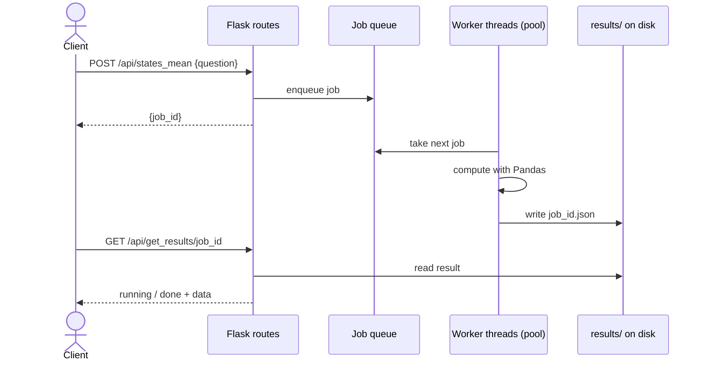

# Le Stats Sportif


A multi-threaded REST server that answers statistical questions about a U.S. public-health dataset (nutrition, physical activity and obesity), **asynchronously**: every request becomes a job, a pool of worker threads computes it, and the client polls for the result.

Built for the Computer Systems Architecture course at UPB (Apr 2025).

## How it works



- A **custom thread pool**: threads are started once and reused, each one pulling jobs from a shared queue, instead of creating a thread per request.
- The pool size comes from `TP_NUM_OF_THREADS`, or the number of CPU cores.
- Results are persisted to disk, so they survive after the worker that computed them moves on.
- **Graceful shutdown**: `/api/graceful_shutdown` stops accepting new jobs and lets the queue drain.
- Requests and errors are logged with Python's `logging` module.

## API

| Endpoint | What it returns |
| --- | --- |
| `POST /api/states_mean` | Mean value per state for a question, sorted |
| `POST /api/state_mean` | Mean for one state |
| `POST /api/best5`, `/api/worst5` | Top / bottom 5 states |
| `POST /api/global_mean` | Mean over the whole dataset |
| `POST /api/diff_from_mean`, `/api/state_diff_from_mean` | Global mean minus state mean |
| `POST /api/mean_by_category`, `/api/state_mean_by_category` | Means split by demographic category |
| `GET /api/get_results/<job_id>` | Job status, or the result when done |
| `GET /api/jobs`, `/api/num_jobs` | All jobs and their status / jobs still running |
| `GET /api/graceful_shutdown` | Stop accepting jobs and drain the queue |

## Run it

```bash
make create_venv
source venv/bin/activate
make install
make run_server      # starts the Flask server
make run_tests       # runs the checker against the API
```

Unit tests live in `unittests/TestWebServer.py`.

## What I would improve

- Unit tests for every statistic, not only one.
- A `concurrent.futures.ThreadPoolExecutor` instead of a hand-written pool in production code (the hand-written pool was the point of the assignment).
- Load the dataset once into typed columns, to avoid string-to-number surprises.
